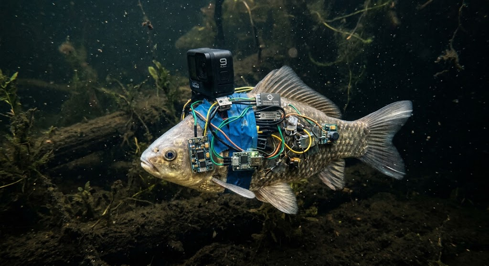

# ТЗ: исследовательское судно «Карась-1»

- **Автор:** Новожилов Евгений
- **Стихия:** вода
- **Проект:** «Безумное средство передвижения»
- **Дата заморозки:** не заморожено
- **Версия:** 0.1

## 1. Назначение

«Карась-1» — условное исследовательское судно для перемещения по водоёму и съёмки подводного маршрута. Судном считается живой карась: направление его движения задаётся концептуальными электростимуляторами, а GoPro примотана изолентой к корпусу и записывает видео. Это учебная модель поведения транспорта, а не инструкция по сборке или воздействию на живое животное.

### Иллюстрация

<!-- Сюда добавить сгенерированное изображение: images/karas-1.png -->


**Промпт для генерации:** «Юмористический концепт-арт вымышленного исследовательского судна „Карась-1“: реалистичный живой карась под водой, на его корпусе слегка нелепо примотана синей изолентой компактная экшн-камера GoPro; рядом условно показаны маленькие фантастические электростимуляторы как элементы научной фантастики, без проводов и технических подробностей. Рыба выглядит невредимой, без ран и крови. Подводная исследовательская сцена, чистая композиция, вид сбоку в профиль, мягкий свет, выразительная, но добродушная подача, без текста, логотипов и водяных знаков.»

## 2. Стихия и конструкционный элемент

**Стихия:** вода.

**Конструкционный элемент:** живой карась, чьи мышцы обеспечивают движение судна в воде.

**Как реализован элемент:** в модели команда движения задаёт направление и расстояние, а абстрактный блок стимуляции активирует движение карася. GoPro, закреплённая изолентой, предназначена для записи маршрута, не влияет на скорость и тратит 1 условную единицу энергии при запуске записи; дополнительный расход во время записи не моделируется.

**Ограничения стихии:**

- штатное движение возможно только в воде;
- выход на сушу и движение по суше не поддерживаются;
- аппарат не ныряет глубже заданного для конкретного экземпляра предела;
- фактические электрические параметры, электроды и способы их крепления настоящему животному не задаются этим проектом.

## 3. Публичный интерфейс

Реализация должна предоставлять только описанное ниже поведение. Неописанные детали являются внутренними.

Для числовых параметров принимаются конечные значения типов `int` или `float`; `bool` числовым значением для этого контракта не считается. `NaN` и бесконечность вызывают `ValueError`. Для всех методов сначала проверяются типы аргументов, затем их значения; только после этого проверяются доменные ограничения и запас энергии. Все доменные исключения экспортируются из модуля `crucian_one.py`.

### 3.1. Класс и модуль

- Имя класса: `CrucianOne`
- Модуль: `crucian_one.py`

### 3.2. Конструктор

```python
def __init__(
    self,
    name: str,
    mass_kg: float,
    body_length_cm: float,
    max_speed_kmh: float,
    max_depth_m: float,
    energy: float = 100.0,
) -> None:
```

| Параметр | Тип | Единица | Допустимое значение | По умолчанию |
|---|---|---:|---|---:|
| `name` | `str` | — | непустая строка после удаления пробелов по краям | — |
| `mass_kg` | `float` | кг | больше 0 | — |
| `body_length_cm` | `float` | см | больше 0 | — |
| `max_speed_kmh` | `float` | км/ч | больше 0 | — |
| `max_depth_m` | `float` | м | больше 0 | — |
| `energy` | `float` | условные единицы | от 0 до 100 включительно | `100.0` |

Конструктор сохраняет `name.strip()` в атрибут `name` и устанавливает `position_km = 0.0`, `is_swimming = True`, `gopro_recording = False`: судно начинает работу в воде. Пустое имя, неположительные физические параметры или энергия вне диапазона вызывают `ValueError`. Параметр неверного типа вызывает `TypeError`.

### 3.3. Публичные атрибуты

Все перечисленные атрибуты доступны только для чтения; попытка присвоить им новое значение вызывает `AttributeError`.

| Атрибут | Тип | Единица | Значение |
|---|---|---:|---|
| `name` | `str` | — | Имя судна |
| `mass_kg` | `float` | кг | Масса карася |
| `body_length_cm` | `float` | см | Длина тела |
| `max_speed_kmh` | `float` | км/ч | Максимальная скорость в воде |
| `max_depth_m` | `float` | м | Максимальная глубина погружения |
| `energy` | `float` | условные единицы | Запас энергии для перемещения и оборудования |
| `position_km` | `float` | км | Суммарное пройденное расстояние |
| `is_swimming` | `bool` | — | Находится ли судно в штатном водном режиме; после успешной команды движения остаётся `True` |
| `gopro_recording` | `bool` | — | Записывает ли GoPro видео |

### 3.4. Методы

#### 3.4.1. `move`

```python
def move(
    self,
    distance_km: float,
    direction: str,
    depth_m: float = 0.0,
    environment: str = "water",
) -> float:
```

Перемещает судно и возвращает длительность команды в часах. `distance_km` должен быть больше 0; `direction` — одно из значений `"north"`, `"south"`, `"east"`, `"west"`; `depth_m` — глубина перемещения от 0 до `max_depth_m` включительно; `environment` — `"water"` или `"land"`.

При `environment == "water"` скорость равна `max_speed_kmh`; затраты энергии равны `distance_km * 2` условных единиц. Время равно `distance_km / max_speed_kmh`. После успешного перемещения расстояние добавляется к `position_km`, энергия уменьшается на рассчитанные затраты, `is_swimming` остаётся `True`. Если энергии недостаточно, выбрасывается `KarasNoEnergy`, состояние не меняется. При `environment == "land"` выбрасывается `KarasCannotMoveOnLand`.

Неположительное расстояние, неизвестное направление, неизвестная среда или глубина вне допустимого диапазона вызывают `ValueError`; аргументы неверных типов вызывают `TypeError`.

#### 3.4.2. `can_pass`

```python
def can_pass(self, obstacle: str) -> bool:
```

Проверяет препятствие, не меняя состояние. Допустимы `"open_water"`, `"narrow_channel"`, `"net"`:

- `open_water` — всегда `True`;
- `narrow_channel` — `True`, если `body_length_cm <= 30`;
- `net` — всегда `False`.

Неизвестное препятствие вызывает `ValueError`.

#### 3.4.3. `start_recording`

```python
def start_recording(self) -> None:
```

Включает запись GoPro и уменьшает энергию на 1 условную единицу. Если энергии меньше 1, выбрасывается `KarasNoEnergy`, состояние не меняется. При повторном вызове во время записи ничего не меняется и энергия повторно не расходуется.

#### 3.4.4. `stop_recording`

```python
def stop_recording(self) -> None:
```

Останавливает запись. Энергия не меняется. Повторный вызов допустим и оставляет запись выключенной.

#### 3.4.5. `get_status`

```python
def get_status(self) -> dict:
```

Возвращает новый словарь-снимок с ключами `name`, `energy`, `position_km`, `is_swimming`, `gopro_recording`. Изменение возвращённого словаря не меняет состояние судна.

## 4. Сценарии

### 4.1. Модульные сценарии (AAA)

1. **Штатное перемещение.** Arrange: `CrucianOne("Карась-1", 0.4, 25, 4, 3, 100)`. Act: `move(2, "east")`. Assert: возвращено `0.5`, `position_km == 2`, `energy == 96`, `is_swimming == True`.
2. **Недостаток энергии.** Arrange: такой же экземпляр с `energy=3`. Act: `move(2, "east")`. Assert: `KarasNoEnergy`; энергия и позиция не изменились.
3. **Узкий канал.** Arrange: экземпляр с `body_length_cm=25`. Act: `can_pass("narrow_channel")`. Assert: `True`; состояние не изменилось.
4. **Запись видео.** Arrange: экземпляр с энергией 10 и выключенной GoPro. Act: `start_recording()`, затем повторный вызов. Assert: запись включена, энергия равна 9.

### 4.2. Сценарные тесты (Given-When-Then)

#### Сценарий: Видео маршрута до узкого канала

**Given:** «Карась-1» длиной 25 см, со скоростью 4 км/ч и энергией 20 находится в воде; запись выключена.

**When:** оператор включает запись и задаёт движение на 2 км на восток.

**Then:** GoPro записывает видео, команда длится 0.5 часа, позиция равна 2 км, энергия равна 15.

**When:** оператор проверяет узкий канал.

**Then:** `can_pass("narrow_channel")` возвращает `True`; состояние не меняется.

#### Сценарий: Исследование глубокого участка

**Given:** судно со скоростью 4 км/ч, максимальной глубиной 3 м и энергией 50 находится в воде.

**When:** оно проходит 1 км на юг на глубине 2.5 м.

**Then:** команда длится `1 / max_speed_kmh` часа, позиция равна 1 км, энергия равна 48.

**When:** оператор задаёт следующий маршрут на глубине 3.5 м.

**Then:** возникает `ValueError`; энергия и позиция не меняются.

#### Сценарий: Съёмка и исчерпание заряда

**Given:** судно с энергией 5 находится в воде; запись выключена.

**When:** оператор включает GoPro.

**Then:** запись включена, энергия равна 4.

**When:** оператор задаёт перемещение на 2.5 км на запад.

**Then:** возникает `KarasNoEnergy`; позиция остаётся 0 км, энергия остаётся 4, запись остаётся включённой.

**When:** оператор останавливает запись.

**Then:** запись выключена, энергия остаётся 4.

#### Сценарий: Препятствие на маршруте

**Given:** судно длиной 35 см находится в воде с энергией 30.

**When:** оператор проверяет открытый водоём, узкий канал и сеть.

**Then:** результаты равны `True`, `False`, `False` соответственно; энергия и позиция не меняются.

### 4.3. Test Case Specification

Полная таблица тест-кейсов с ID, типами, источниками, входами, ожиданиями и приоритетами приведена в [TEST_CASES.md](TEST_CASES.md). В ней 19 модульных и 4 сценарных кейса; соотношение составляет примерно 80 / 20.

## 5. Граничные случаи

- `move(0, "north")` вызывает `ValueError`; позиция и энергия не меняются.
- `move(1, "north", environment="land")` вызывает `KarasCannotMoveOnLand`; позиция и энергия не меняются.
- Движение ровно на `max_depth_m` разрешено; значение глубины чуть больше предела вызывает `ValueError` без изменения состояния.
- При энергии ровно 4 вызов `move(2, "east")` успешен и оставляет энергию 0; следующий вызов движения вызывает `KarasNoEnergy`.
- Повторный `start_recording()` не списывает энергию повторно; вызов при энергии 0 выбрасывает `KarasNoEnergy`.

## 6. Исключения

Иерархия доменных исключений:

```text
CrazyVehicleError
└── KarasError
    ├── KarasNoEnergy
    └── KarasCannotMoveOnLand
```

| Ситуация | Исключение | Результат для состояния |
|---|---|---|
| Аргумент имеет неверный тип | `TypeError` | Состояние не меняется |
| Имя пустое, физическая величина недопустима, неверное направление/препятствие | `ValueError` | Состояние не меняется |
| Запрошено движение по суше | `KarasCannotMoveOnLand` | Состояние не меняется |
| Не хватает энергии на движение или запуск GoPro | `KarasNoEnergy` | Состояние не меняется |

Иерархия экспортируемых классов: `CrazyVehicleError(Exception)`, `KarasError(CrazyVehicleError)`, `KarasNoEnergy(KarasError)`, `KarasCannotMoveOnLand(KarasError)`. Проверки аргументов выполняются до изменения состояния.

## 7. Что вне рамок

- Реальное изготовление электростимуляторов, подключение электродов, подбор параметров воздействия и проведение опытов на живом животном.
- Медицинские, ветеринарные и биологические рекомендации; оценка безопасности или допустимости такого воздействия.
- Физическая сборка судна, радиоканал, электроника, питание GoPro, получение и хранение видео.
- Графический интерфейс, работа с внешними файлами, сетью, датчиками и API.
- Одновременное управление несколькими судами и моделирование поведения или состояния здоровья животного.

## 8. Трассируемость «требование → тест»

Идентификаторы относятся к будущему `TEST_CASES.md`; имя метода теста должно включать ID в docstring.

| Требование | Раздел | TC / тест |
|---|---:|---|
| Конструктор принимает корректные параметры и задаёт начальное состояние | 3.2–3.3 | TC-01 `test_TC_01_constructor_initial_state` |
| Пустое имя отклоняется | 3.2 | TC-02 `test_TC_02_empty_name` |
| Неположительные физические параметры отклоняются | 3.2 | TC-03 `test_TC_03_non_positive_physical_values` |
| Энергия проверяется на границах 0…100 | 3.2 | TC-04 `test_TC_04_energy_range` |
| Неверный тип аргумента публичного API вызывает `TypeError` | 3.2, 3.4.1–3.4.2, 6 | TC-05 `test_TC_05_wrong_argument_types` |
| Перемещение рассчитывает время, расход энергии и позицию | 3.4.1 | TC-06 `test_TC_06_move_updates_state` |
| Точное исчерпание энергии разрешено, следующий ход невозможен | 3.4.1, 5 | TC-07 `test_TC_07_exact_energy_boundary` |
| Недостаток энергии не меняет состояние | 3.4.1, 6 | TC-08 `test_TC_08_move_without_energy` |
| Дистанция, направление, среда и глубина валидируются | 3.4.1, 5 | TC-09 `test_TC_09_invalid_route_parameters` |
| Движение по суше вызывает доменное исключение | 3.4.1, 6 | TC-10 `test_TC_10_cannot_move_on_land` |
| Открытый водоём проходим | 3.4.2 | TC-11 `test_TC_11_open_water` |
| Предельная длина для узкого канала включена | 3.4.2 | TC-12 `test_TC_12_narrow_channel_boundary` |
| Длинная рыба не проходит канал, сеть непроходима, неизвестное препятствие отклоняется | 3.4.2 | TC-13 `test_TC_13_channel_net_and_unknown` |
| Запуск записи списывает энергию один раз | 3.4.3, 5 | TC-14 `test_TC_14_start_recording_once` |
| Запись нельзя запустить без энергии | 3.4.3, 6 | TC-15 `test_TC_15_recording_without_energy` |
| Остановка записи идемпотентна и не тратит энергию | 3.4.4 | TC-16 `test_TC_16_stop_recording` |
| Статус содержит заданные ключи и является отдельным снимком | 3.4.5 | TC-17 `test_TC_17_status_snapshot` |
| Публичные атрибуты доступны только для чтения | 3.3 | TC-18 `test_TC_18_public_attributes_are_read_only` |
| Доменные исключения наследуются по указанной иерархии | 6 | TC-19 `test_TC_19_domain_exception_hierarchy` |
| Съёмка маршрута и прохода через канал выполняются по сценарию | 4.2 | TC-20 `test_TC_20_record_and_pass_channel` |
| Глубина выше предела отклоняется без побочных изменений | 4.2, 5 | TC-21 `test_TC_21_depth_limit_scenario` |
| Нехватка энергии во время съёмки сохраняет состояние | 4.2, 6 | TC-22 `test_TC_22_recording_and_empty_charge` |
| Препятствия проверяются без изменения состояния | 4.2 | TC-23 `test_TC_23_obstacle_route_scenario` |

## 9. Открытые вопросы

- Нужно ли преподавателю отдельно утвердить фантастическую концепцию движения живого карася до заморозки ТЗ?
- Достаточно ли для учебной модели одного состояния записи GoPro без хранения самого видео?
